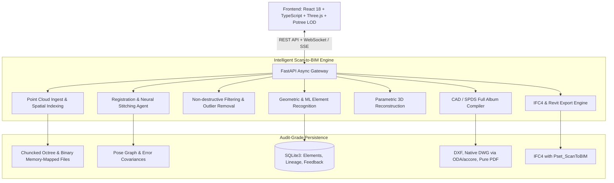

# ARCHITECTURE — SCAN: Intelligent Point Cloud Studio

## 1. Overview and Design Principles

**SCAN** is a professional, standalone desktop-and-web workstation application for Windows 11 designed to ingest, stitch, filter, recognize, reconstruct, and draft building elements from dense laser scan point clouds into CAD and BIM deliverables.

### Core Non-Negotiable Tenets:
1. **Zero Simulation**: Every action corresponds to real computational geometry or verifiable statistical learning. No dummy placeholders.
2. **Provenance-Preserving**: Raw scan points, intermediate registration graphs, fitted candidate primitives, and engineer-confirmed elements are kept separate and strictly audited.
3. **Local-First & Offline-Capable**: Fully functional on local Windows 11 without cloud dependencies or external proprietary APIs. Optional local NVIDIA GPU acceleration with reliable CPU fallbacks.
4. **SPDS / GOST & ISO Standards**: Outputs valid DXF/DWG/PDF engineering sheets (GOST 21.101-2020, GOST 21.501-2018, SP 70.13330.2012) and IFC4 with rich `Pset_ScanToBIM` metadata for Autodesk Revit 2027 and Autodesk ReCap.

---

## 2. System Architecture



---

## 3. Directory Layout and Component Roles

```
intelligent-scan-to-bim/
├── backend/
│   ├── scan2bim/
│   │   ├── api/                 # FastAPI routes, schemas, async job queue
│   │   ├── bim/                 # IFC4 generation via IfcOpenShell, Revit parameter mapping
│   │   ├── cad/                 # DXF (ezdxf), DWG compiler (ODA / accoreconsole), SPDS sheet layouts
│   │   ├── geometry/            # Point slicing, rasterization, vectorization, RANSAC fitting
│   │   ├── learning/            # Feature extraction, KNN prior, dataset management, fine-tuning
│   │   ├── pointdata/           # Spatial indexing (k-d tree, octree), chunked streaming
│   │   ├── recognition/         # Walls, columns, beams, trusses, braces, stairs, openings
│   │   ├── registration/        # Neural BEV matching, Point-to-Plane ICP, pose graph optimization
│   │   └── structure/           # Workshop topology (СП 16/56/70), column section series & fitting
│   └── tests/                   # 490+ unit and integration tests (pytest)
├── frontend/
│   ├── src/
│   │   ├── components/          # Viewer3D, ElementTable, ColumnAnnotationPanel, SPDS Panels
│   │   ├── structuralGrid3D.ts  # Real-time SPDS axis bubbles and 3D alignment lines
│   │   ├── elementEvidence.ts   # Engineering badges, uncertainty metrics, proof-of-geometry
│   │   └── api.ts               # Fully-typed backend client
│   └── dist/                    # Production bundle (Vite + TypeScript)
├── docs/                        # Architecture, roadmap, validation benchmarks, SPDS specifications
└── scripts/                     # Automated testing, batch conversions, verification harnesses
```

---

## 4. Subsystem Details

### 4.1. Point Cloud Ingestion & Indexing (`backend/scan2bim/pointdata`)
- **Formats**: E57, LAS/LAZ, PLY, PTS, XYZ, Autodesk ReCap (RCP/RCS).
- **Storage Strategy**: Memory-mapped binary coordinates (`positions.npy`), intensity, and colors.
- **Indexing**: Chunked Morton-coded spatial octree and `cKDTree` supporting multi-million point spatial queries within millisecond latencies without loading entire datasets into heap memory.

### 4.2. Multi-Station Registration & Stitching (`backend/scan2bim/registration`)
- **Stage A (Analysis)**: Automatic bounding box, density estimation, and ground plane alignment.
- **Stage B (Global Coarse Matching)**: BEV (Bird's Eye View) multi-channel structural feature tensors (density + $\Delta Z$ height + occupancy) convolved via 2D FFT with continuous 3D candidate verification to break $180^\circ$ symmetric hall traps.
- **Stage C (Fine Registration)**: Point-to-Plane ICP with adaptive normal estimation converging to sub-millimeter residuals ($\text{RMSE} < 0.1\text{ mm}$ on clean structural targets).
- **Stage D (Global Network Adjustment)**: Multi-station Pose Graph Optimization (loop closure) minimizing accumulated drift.

### 4.3. Structural & Architectural Recognition (`backend/scan2bim/recognition`)
- **Industrial Framework**:
  - Vertical structural columns with column-step profiles (crane bracket transition).
  - Crane runways and girders (`beam`, `crane_girder`).
  - Roof trusses and bracing (`truss`, `brace`, `roof_brace`).
  - Inclined surfaces between storeys (`stair`).
  - Wall openings with verified lintels and jambs (`opening`).
- **Classification Separation**:
  1. *Observed Geometry*: Physical points, bounding box, oriented bounding box.
  2. *Hypothesis Role*: Class, nominal grid association, deviation.
  3. *Engineer Review Status*: `unreviewed`, `confirmed`, `rejected`, `modified`.

### 4.4. SPDS / CAD Drafting Engine (`backend/scan2bim/cad`)
- Pure vector CAD primitives generated strictly from measured and verified geometry:
  - **Sheet 01**: Column layout plan at el. 0.000 (M 1:200).
  - **Sheet 02**: Crane runway layout at el. +6.800 (M 1:200).
  - **Sheet 03**: Transverse building section 1-1 (M 1:100).
  - **Sheet 04**: Roof truss and bracing structural plan (M 1:200).
  - **Sheet 05**: Executive Geodetic Deviation Scheme with SP 70 tolerance compliance table (GOST R 51872-2019).
- **Native DWG Generation**: Direct conversion via installed `ODAFileConverter` or AutoCAD `accoreconsole.exe`.

---

## 5. Reliability, Security & Traceability

- **Non-destructive Operations**: Original raw scans are treated as read-only.
- **SHA-256 Provenance Ledger**: Every generated DXF, DWG, PDF, and IFC file is stamped with the SHA-256 hash of the canonical element set and point source manifest.
- **Active Testing & Verification**: Changes are verified with `pytest` (backend) and `npm test` + `npm run build` (frontend) before any release commit.
